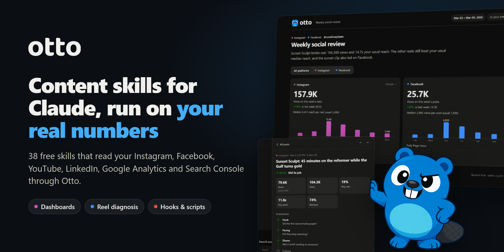
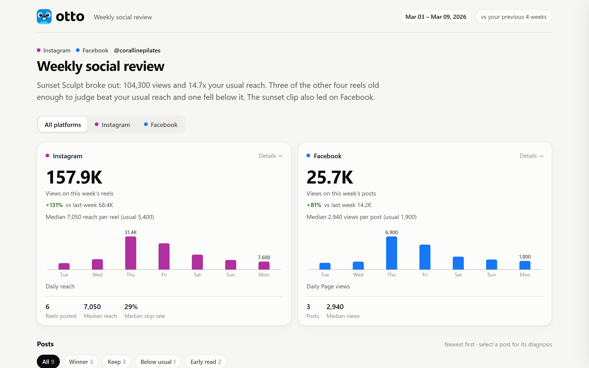
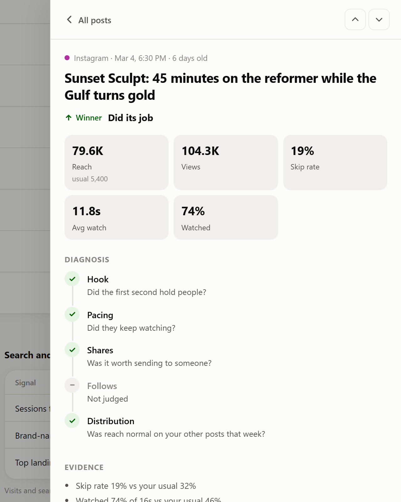
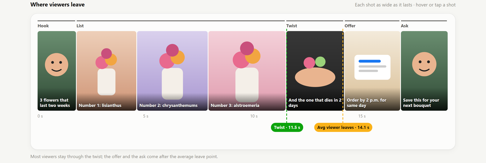
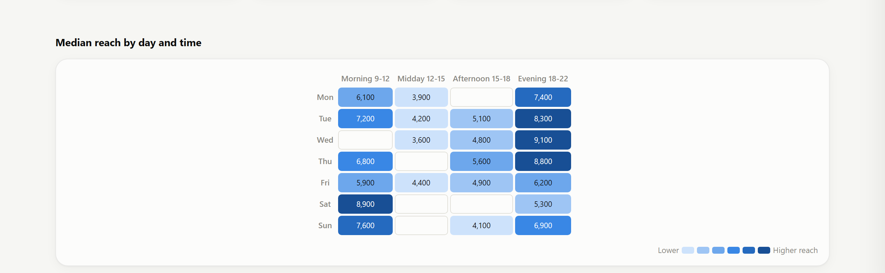

<p align="center">
  
</p>

<h3 align="center">38 free AI skills that turn your real social media numbers into your next post.<br><sub>Built for Claude. Also runs in ChatGPT, Cursor and any app that supports Agent Skills and MCP.</sub></h3>

<p align="center">
  <a href="https://ottowebmaster.com/mcp"></a>
</p>

<p align="center">
  <a href="LICENSE"></a>
  
  
  <a href="https://github.com/IslaIntel/otto-content-skills"></a>
</p>

---

**TL;DR**

- **What:** skills for Claude that read your Instagram, Facebook, YouTube, LinkedIn, Google Analytics, Search Console and Google Business Profile through [Otto](https://ottowebmaster.com), then review, diagnose, plan and write your content.
- **Why it's different:** you never export or paste stats. Every number comes live from your accounts and is judged against **your own** track record, not someone else's benchmark.
- **What you get:** clean dashboards, a frame-by-frame look at your reels, hooks and scripts modelled on your own best posts, and nothing posted without your yes.
- **Start:** [connect Otto](#1-connect-otto-to-claude-2-minutes), [install the skills](#2-install-the-skills), then ask Claude *"weekly review"*.

## Contents

- [See it](#see-it)
- [Quick start](#quick-start)
- [The skills](#the-skills)
- [How it works](#how-it-works)
- [Which Claude should I use?](#which-claude-should-i-use)
- [Use it outside Claude](#use-it-outside-claude)
- [FAQ](#faq)
- [Contributing](#contributing) · [Star the repo](#star-the-repo) · [License](#license)

## See it

Ask *"how did my posts do this week?"* and you get a dashboard, not a wall of text: totals against last week, every post newest first, and a click-through diagnosis for each one.

<picture>
  <source media="(prefers-color-scheme: dark)" srcset="assets/weekly-review-dark.png">
  
</picture>

<table>
  <tr>
    <td width="42%" valign="top">
      <b>Why did this reel work (or flop)?</b><br>
      <sub>Five checks in order: hook, pacing, shares, follows (from your in-app screenshot), distribution. It stops at the first one that failed and gives you one fix.</sub><br><br>
      <picture>
        <source media="(prefers-color-scheme: dark)" srcset="assets/reel-diagnosis-dark.png">
        
      </picture>
    </td>
    <td width="58%" valign="top">
      <b>Where exactly do people leave?</b><br>
      <sub>Reel breakdown watches the video, finds every cut and marks the moment the average viewer leaves.</sub><br><br>
      <picture>
        <source media="(prefers-color-scheme: dark)" srcset="assets/reel-breakdown-dark.png">
        
      </picture>
      <br><br>
      <b>When does your audience actually show up?</b><br>
      <sub>Best time to post, from your own history, in your timezone.</sub><br><br>
      <picture>
        <source media="(prefers-color-scheme: dark)" srcset="assets/best-time-dark.png">
        
      </picture>
    </td>
  </tr>
</table>

<sub>Screenshots use a demo account: Coralline Pilates (@corallinepilates) is an invented studio and its numbers are made up. Yours fill with your own.</sub>

## Quick start

### 1. Connect Otto to Claude (2 minutes)

1. Create your account at [ottowebmaster.com](https://ottowebmaster.com) and connect the accounts you want Claude to read: Instagram, Facebook, YouTube, LinkedIn, Google Analytics, Search Console, Google Business Profile. Skills only use what you connect.
2. In claude.ai, open **Customize → Connectors** and add a connector named **Otto** with this URL:
   ```
   https://otto.islaintel.com/api/mcp
   ```
3. Sign in and approve access, then open a **new** chat (existing chats don't pick up new connectors).

Step-by-step with screenshots: [How do I connect Claude?](https://ottowebmaster.com/introduction/mcp/claude) · [ChatGPT](https://ottowebmaster.com/introduction/mcp/chatgpt) · [Cursor](https://ottowebmaster.com/introduction/mcp/cursor)

### 2. Install the skills

| Where you use Claude | How |
|---|---|
| **claude.ai / Claude desktop / Cowork** | Download `otto-content-skills-plugin.zip` from [Releases](https://github.com/IslaIntel/otto-content-skills/releases/latest), then **Customize → Plugins → Upload plugin**. All 38 skills at once. Or zip a single skill folder and upload it under **Customize → Skills**. **Code execution and file creation** must be on (Settings → Capabilities). |
| **Claude Code** | `/plugin marketplace add IslaIntel/otto-content-skills` then `/plugin install otto-content-skills@otto-content-skills` |
| **Let Claude Code do it** | Paste this into Claude Code: *"Install the skills from https://github.com/IslaIntel/otto-content-skills"*. Claude Code clones the repo and runs `install.sh`, which copies the skills into `~/.claude/skills`. |
| **Copy the files** | `git clone https://github.com/IslaIntel/otto-content-skills`, then `cd otto-content-skills`, then `./install.sh` (macOS / Linux) or `powershell -ExecutionPolicy Bypass -File .\install.ps1` (Windows). A folder with the same skill name in `~/.claude/skills` is replaced. |

### 3. Try it

Start with these, in this order:

```
Set up my brand brain.
```
```
Weekly review.
```
```
Why did my last reel flop?
```

> [!TIP]
> On claude.ai, put the **brand card** that brand-brain gives you into a Claude **Project**, and run your chats inside that Project. The skills then stop asking which account, timezone or style you want.

> [!NOTE]
> **Like it?** [⭐ Star the repo](https://github.com/IslaIntel/otto-content-skills) (top right on GitHub). It's free, takes one click, and keeps new skills coming.

## The skills

Every skill pulls live data through Otto and compares it with **your usual** (the median of your own posts from the last 28 days, counting posts at least 3 days old). Reports come as a dashboard you can click through; writing skills give you the finished text. Or ask for any of it in chat.

### Measure: what's working

| Skill | What it does | Ask Claude |
|---|---|---|
| [weekly-social-review](skills/weekly-social-review/SKILL.md) | One dashboard for the week: total views per platform, every post, a click-through diagnosis for each reel, and at most 3 changes for next week | *"Weekly review"* |
| [daily-pulse](skills/daily-pulse/SKILL.md) | The same dashboard for yesterday: what's taking off, what stalled, what to remix today | *"How did yesterday's posts do?"* |
| [reel-diagnosis](skills/reel-diagnosis/SKILL.md) | The exact step a reel lost people (hook, pacing, shares, follows or distribution) and the one fix | *"Why did this reel flop?"* |
| [content-scorecard](skills/content-scorecard/SKILL.md) | The last 30 days, trait by trait against your median: stop, keep, test, and your next five posts | *"Audit my content"* |
| [hook-patterns](skills/hook-patterns/SKILL.md) | Ranks your own opening lines by skip rate and watch time, finds the patterns, remixes the winners | *"Which openings work for me?"* |
| [best-time-to-post](skills/best-time-to-post/SKILL.md) | When your posts do best, in your timezone, with an honest read on sample size | *"What time do my posts do best?"* |
| [hook-test](skills/hook-test/SKILL.md) | A fair one-variable A/B test, decided before you post and scored from live data | *"Test these two hooks"* |
| [campaign-retro](skills/campaign-retro/SKILL.md) | Everything a launch moved (posts, site visits, tracked links, ads) and what to repeat | *"How did the promo do?"* |
| [search-and-social](skills/search-and-social/SKILL.md) | What people search on Google and YouTube that you haven't posted about, and the words to put in captions | *"What are people searching for?"* |
| [utm-builder](skills/utm-builder/SKILL.md) | Clean tracking links, then checks in Google Analytics that the visits arrive | *"Tag my links"* |

### Research: what to make next

| Skill | What it does | Ask Claude |
|---|---|---|
| [reel-breakdown](skills/reel-breakdown/SKILL.md) | Watches a reel frame by frame: hook, cuts, on-screen text, where viewers leave, what to borrow | *"Break down this reel"* |
| [topic-finder](skills/topic-finder/SKILL.md) | Topics ranked by real demand: searched, watched, asked about, sellable | *"What topics would do well for me?"* |
| [trend-radar](skills/trend-radar/SKILL.md) | Rising topics from your search and comment data, each marked take, adapt or skip | *"What's trending for businesses like mine?"* |
| [comment-insights](skills/comment-insights/SKILL.md) | Every question and objection in your comments and reviews, turned into post ideas and an FAQ | *"What are people asking in my comments?"* |
| [audience-map](skills/audience-map/SKILL.md) | Who you actually reach, with a source on every line | *"Who is my audience?"* |
| [competitor-watch](skills/competitor-watch/SKILL.md) | The pattern behind rivals' best posts and ads, and the gaps you can own | *"Break down this competitor"* |
| [message-check](skills/message-check/SKILL.md) | Whether your site, bio and posts say one clear thing that matches what people search | *"Is our message clear?"* |
| [social-proof-finder](skills/social-proof-finder/SKILL.md) | A graded bank of reviews and wins, with permission to use each tracked | *"Find testimonials"* |

### Create: from idea to finished post

| Skill | What it does | Ask Claude |
|---|---|---|
| [brand-brain](skills/brand-brain/SKILL.md) | Claude's memory of your business (voice, audience, offer, best posts, brand look), seeded from your real data. **Run this first.** | *"Set up my brand brain"* |
| [viral-reel-planner](skills/viral-reel-planner/SKILL.md) | Plans a reel backwards from the result you want, checked against your own winners | *"Plan a reel"* |
| [hook-writer](skills/hook-writer/SKILL.md) | 10 hooks (spoken line, first frame, on-screen text), ranked against hooks that worked for you | *"Write me a hook"* |
| [reel-script](skills/reel-script/SKILL.md) | A beat-by-beat script sized to how long your viewers actually watch | *"Script this reel"* |
| [shot-list](skills/shot-list/SKILL.md) | A phone-only filming plan: every shot grouped by location, with framing and the line it covers | *"Shot list for this script"* |
| [cover-designer](skills/cover-designer/SKILL.md) | Reel and Shorts covers designed over a clean frame of your own footage, checked for the grid crops | *"Design my reel cover"* |
| [carousel-designer](skills/carousel-designer/SKILL.md) | 7-10 slides designed in your brand, modelled on your most-saved carousels | *"Make this a carousel"* |
| [story-sequence](skills/story-sequence/SKILL.md) | Story arcs with polls and stickers placed to earn taps and DMs | *"What should my stories be today?"* |
| [caption-writer](skills/caption-writer/SKILL.md) | Captions in your style (or your own template), with keywords from real Google searches | *"Write a caption"* |
| [sound-human](skills/sound-human/SKILL.md) | Takes the AI tone out of scripts and captions so they sound like you | *"Make it sound like me"* |
| [linkedin-post](skills/linkedin-post/SKILL.md) | Founder posts from real work, for your profile or your Company Page | *"Write a LinkedIn post"* |

### Grow: turn views into customers

| Skill | What it does | Ask Claude |
|---|---|---|
| [content-engine](skills/content-engine/SKILL.md) | Runs the whole loop (research, plan, write, post, reply, measure) and stops for your approval at each step | *"Run the content engine"* |
| [posting-plan](skills/posting-plan/SKILL.md) | A 2-4 week plan around your winners and what's already planned | *"Plan my next two weeks"* |
| [post-queue](skills/post-queue/SKILL.md) | Posts your finished, approved content at the times you pick, using your AI app's scheduled tasks. Test it on one post first | *"Post this at 9am tomorrow"* |
| [content-pillars](skills/content-pillars/SKILL.md) | 3-5 themes chosen from evidence, with 10 ideas each | *"Build my content pillars"* |
| [repurpose](skills/repurpose/SKILL.md) | Turns your best video or post into reels, a carousel, LinkedIn and Facebook posts, and a blog outline | *"Repurpose my best video"* |
| [comment-to-lead](skills/comment-to-lead/SKILL.md) | Sorts comments, drafts replies, and writes the DM flow to a booked call | *"Reply to my comments"* |
| [profile-check](skills/profile-check/SKILL.md) | Fixes your bio, link and pinned posts so visitors know what to do next | *"Check my profile"* |
| [creator-collab](skills/creator-collab/SKILL.md) | Vet a creator, draft the outreach and brief, and measure the collab. You send every message. | *"Is this creator a good fit for us?"* |
| [campaign-plan](skills/campaign-plan/SKILL.md) | A one-page brief with targets worked back from your real organic and ad numbers | *"Plan a campaign"* |

## How it works

- **Your numbers, not benchmarks.** "Your usual" is the median of your own posts from the last 28 days (posts at least 3 days old), the same definition in every skill. A reel is good or bad compared with what *your* account usually does.
- **Ask once, remembered.** The first run asks a few quick questions (which account, which platforms, timezone, dashboard or chat). With a folder (Claude Code, Cowork) they're saved in `brand/settings.md`; in claude.ai they live in your Project or Claude's memory.
- **Only what you asked for.** Say "my Instagram" and you get Instagram only. Platforms you haven't connected get one line with a connect link, never an empty chart.
- **Nothing goes out without you.** Anything that posts, replies, schedules or touches ads shows you exactly what will happen and waits for your yes. What a skill can do for you depends on what your Otto connection includes; when it can't post for you, it hands you the finished file and the steps.
- **Visuals are made in code.** Dashboards, covers and carousel slides are designed by Claude from your brand and your own footage. No AI-generated photos.
- **Honest about gaps.** When a platform doesn't share a number (per-reel follows, Story insights), the skill says so instead of guessing.

## Which Claude should I use?

All of them work. They differ in where your settings live and what Claude can do with files.

| | claude.ai | Claude desktop / Cowork | Claude Code |
|---|---|---|---|
| Best for | Quick reviews and writing | Most people: one folder for everything, no code | People comfortable with a terminal |
| Your brand brain | A Claude **Project** (paste the brand card) | A `brand/` folder on your computer | A `brand/` folder on your computer |
| Dashboards | Artifact in the chat | Artifact (desktop chat) or HTML file (Cowork) | HTML file in your browser |
| Video skills | Upload the MP4 | Works on the file | Works on the file |
| Posting at set times (`post-queue`) | Not available | Scheduled tasks | Scheduled tasks (desktop app; cloud agents can't read local files) |

## Use it outside Claude

The skills follow the open [Agent Skills](https://agentskills.io) format (a folder with a `SKILL.md`), and Otto is a standard remote MCP connector. So they work in any AI app that supports both:

| App | Connect Otto | Add the skills |
|---|---|---|
| **ChatGPT** (Business, Enterprise, Edu) | [Otto's ChatGPT guide](https://ottowebmaster.com/introduction/mcp/chatgpt) | **Skills → Create → Upload from computer**, one skill folder (zipped) at a time |
| **Cursor** | [Otto's Cursor guide](https://ottowebmaster.com/introduction/mcp/cursor) | Cursor reads `.cursor/skills/` and `.claude/skills/`. Clone this repo, then from your project folder run its installer with the target set: `OTTO_SKILLS_DIR=.cursor/skills /path/to/otto-content-skills/install.sh` (macOS / Linux) or `$env:OTTO_SKILLS_DIR='.cursor\skills'; powershell -ExecutionPolicy Bypass -File C:\path\to\otto-content-skills\install.ps1` (Windows) |
| **Codex, Gemini CLI, GitHub Copilot, Goose and others** | Add `https://otto.islaintel.com/api/mcp` as a remote MCP server | Copy the `skills/` folders to wherever the app loads skills from (from the cloned repo: `OTTO_SKILLS_DIR=<that folder> ./install.sh`) |

Built and tested on Claude first. Dashboards need an app that can create files or render HTML; where it can't, ask for the result in chat.

## FAQ

<details>
<summary><b>Do I need an Otto account?</b></summary>

Yes. The skills read your data through the Otto connector; that's what lets them skip the copy-paste step. Create an account at [ottowebmaster.com](https://ottowebmaster.com) and see [what the connector can do](https://ottowebmaster.com/mcp).
</details>

<details>
<summary><b>Do I need Obsidian or another notes app?</b></summary>

No. Claude's memory here is a plain folder of text files (`brand/` and `social-data/`) that the skills create and keep up to date. Open it with any app you like. In claude.ai, a Project does the same job.
</details>

<details>
<summary><b>Is my data private?</b></summary>

The skills read your numbers through your own Otto connection and keep history in files on your computer (or in your chat). The skills don't send your data anywhere except Otto and the AI app you're using. Your ad and analytics credentials stay in Otto; Claude only gets the connector.
</details>

<details>
<summary><b>Will it post or reply without asking?</b></summary>

No. Reviews and research are read-only. Anything that posts, replies, schedules or changes ads shows the exact content first and waits for you to say yes.
</details>

<details>
<summary><b>Which platforms are supported?</b></summary>

Through Otto today: Instagram (posts, reels, watch time, skip rate, comments), Facebook Pages, LinkedIn, YouTube, Google Analytics 4, Search Console and Google Business Profile. **Coming soon:** TikTok and X analytics and Instagram Story insights. Until then, skills that need them ask for a screenshot.
</details>

<details>
<summary><b>Does it work in ChatGPT or Cursor?</b></summary>

Yes. Both the Otto connector and the skills work there; see [Use it outside Claude](#use-it-outside-claude) for the steps. The skills are built and tested on Claude first, so that's where they run smoothest.
</details>

<details>
<summary><b>A skill didn't run. What do I check?</b></summary>

- Ask for it by name: *"Use the weekly-social-review skill…"*.
- Make sure **code execution and file creation** is on (claude.ai Settings → Capabilities).
- Start a **new** chat after adding the Otto connector.
- Run *"List my Otto connections"* to confirm Claude can see your accounts.
</details>

## Contributing

Ideas, bug reports and new skills are welcome: open an issue or a pull request. [docs/AUTHORING.md](docs/AUTHORING.md) explains how every skill here is written and the rules they share. Every skill is tested against a live Otto account before it ships.

## Star the repo

If a skill saved you an hour, [⭐ star the repo](https://github.com/IslaIntel/otto-content-skills). GitHub has no one-click star link, so it's the ☆ **Star** button at the top right of this page. Stars tell us people want more of these, and help other small businesses find them.

## License

[MIT](LICENSE). In plain words: you can use these skills for free, for yourself or for clients, change them, and share or sell what you build with them. The one condition is to keep the copyright and license notice in any copy you pass on. They come as they are, with no warranty.

The license covers the skills, templates and scripts. The Otto name, logo and mascot are Otto's brand and aren't licensed for reuse (see [NOTICE](NOTICE)).

---

<p align="center">
  <a href="https://ottowebmaster.com"></a><br>
  <sub>Otto is the AI webmaster and marketer for small businesses. These skills are the do-it-yourself version; <a href="https://ottowebmaster.com">Otto</a> can run them for you.</sub>
</p>
